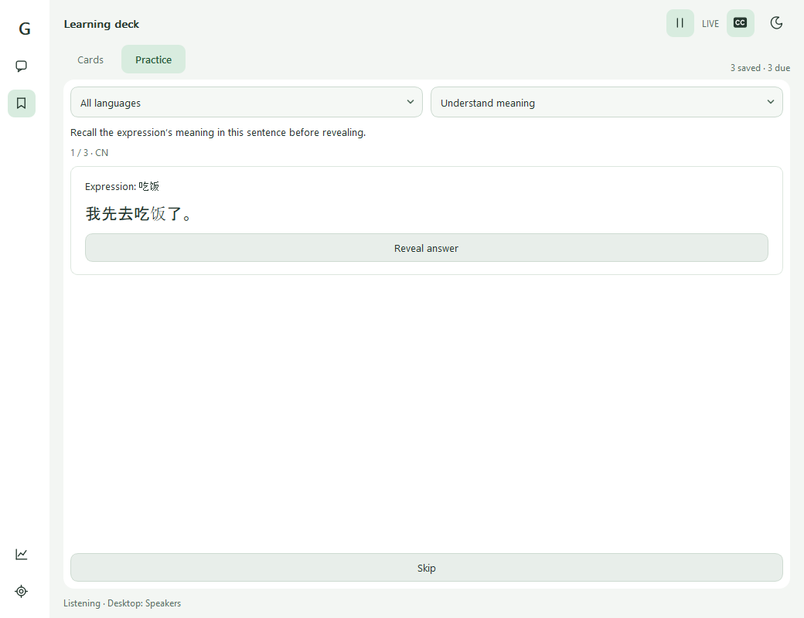
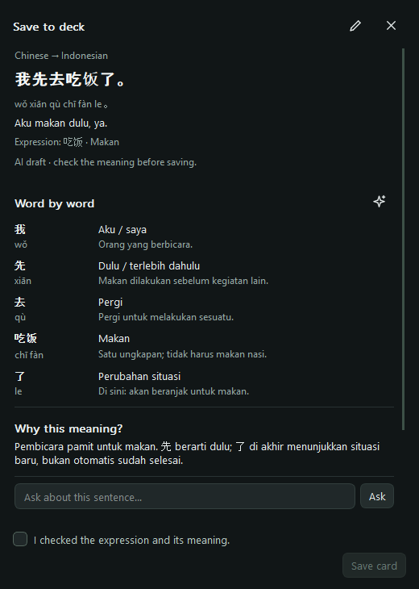

# GrammAI

Local Windows transcription, translation, pronunciation, and language learning.

**Version: [v0.9.8](https://github.com/androschen/grammai/tree/v0.9.8)**


*Actual PySide6 UI rendered with synthetic examples. No personal cards, conversations, recordings, or credentials are shown.*

## What's new

- **One window:** switch between Conversation and Learning deck using the sidebar. Wide layouts show cards beside their details; compact layouts use an inline Back arrow.
- **Persistent learning:** save expressions with their original sentence, pronunciation, meaning, notes, and local AI explanations. Cards stay on disk across restarts.
- **Contextual explanations:** request sentence meaning, word/phrase breakdowns, and reasons based on original speech and nearby dialogue. Ask local follow-up questions or refresh older explanations.
- **Recall practice:** reveal saved explanations after attempting recall. Opening saved explanations and revealing answers require no inference.
- **Simple model settings:** selected and running models are shown separately. Speech recognition supports CPU/int8 faster-whisper and a configured whisper.cpp Vulkan backend; local Qwen handles contextual text tasks.
- **Compact subtitles:** fixed row heights and font size, with long text shown in pages. Complete text remains in session history.
- **Reliable capture:** dropped audio chunks reset speech/context buffers to avoid joining unrelated audio.

The v0.9.8 source passed **211 automated tests**, and the Windows package was checked separately. See [CHANGELOG](CHANGELOG.md) for the intervening local desktop builds.



## Run

Build the Windows installer and portable package using the instructions in [WINDOWS.md](WINDOWS.md):

- Installer: `dist/GrammAI-Setup-0.9.8.exe`
- Portable package: `dist/GrammAI-Portable-0.9.8.zip`

Python is bundled in packaged builds; model weights remain separate. These generated packages are excluded from this repository.

For development:

```powershell
python -m pip install -r requirements.txt
python main.py
```

Select desktop loopback or a microphone, choose languages, and press Play. The CC button controls the transparent desktop overlay independently of transcription. The theme button switches between light and dark appearance.

## Conversation and local models

Chinese, Thai, English, and Indonesian are supported, with automatic language options. Chinese pinyin and Thai romanization use local pronunciation helpers.

Open **Settings > Models** to choose speech and translation settings. The selected GPU speech-model file determines the model being used; choosing a quality preset does not download or replace that file. Technical paths and thread controls are under Advanced. Live monitoring shows the active backend, timing, queues, CPU, and memory.

Translation modes:

- **Fast:** NLLB on CPU/int8.
- **Context-aware:** the configured local Qwen model uses bounded original-language dialogue; NLLB is the fallback if local translation fails.
- **Fast + review:** show the fast translation, then automatically review completed sentences with local Qwen. An AI marker identifies refinement; sentence details retain the first translation.

AMD GPUs on Windows can use the configured Vulkan runtimes. Learning explanations, live Qwen translation, and automatic review share a serialized local runtime. When context-aware translation owns that runtime, pause it before requesting a manual learning explanation. No additional model is downloaded for learning cards.

Model output can be mistaken. Source-coverage validation checks that breakdown entries match the original speech; it does not prove the meanings are correct. Selected translated text is never treated as evidence of what was spoken.

## Learning deck

Select an expression in Conversation or Sentence details, right-click, and choose **Create learning card (local AI)**. Check the suggested meaning, add your notes, and save. The Save to deck workflow remains a popup.

Use the sidebar bookmark to browse cards in the main window. Search expressions, meanings, or notes and filter by language. Select a card to read its conversation example and explanation. The pencil opens expression/meaning editing; notes can be saved directly. Text corrections reset the practice schedule and invalidate the old explanation; note-only changes preserve both.

For cards without a breakdown, choose **Explain sentence**. The sparkle action refreshes existing breakdowns. Local Qwen generates a bounded original-speech explanation with up to 24 word/phrase entries, with one correction attempt if source coverage is incomplete. Longer inputs use a clearly identified excerpt. Generation respects the existing deeper-reasoning preference when the context limit allows it.

Saved explanations are reused. Follow-up **Ask** replies are temporary; copy useful details into notes before quitting. Search, selected cards, unsaved drafts, and Practice progress remain in memory when switching sidebar pages. Save notes explicitly to keep them after quitting.



### Practice

Choose **Understand meaning** or **Recall expression**, then practise up to 10 due, reviewed cards. Answers, pronunciation, explanations, and notes stay hidden until Reveal. Reading an already saved answer requires no model call.

- Again schedules a retry after 10 minutes.
- Remembered starts at one day and doubles the interval up to 365 days.
- Skip leaves the schedule unchanged.

This is a lightweight recall scheduler, not a full Anki implementation. Cards are text-only, limited to **1,000 cards / 2 MB** in total.

## Where data is saved

The installed Windows app uses `%LOCALAPPDATA%\GrammAI`:

- `phrases.json`: saved cards, examples, notes, explanations, and review schedules.
- `preferences.json`: app preferences and model selections.
- `benchmarks.json`: benchmark summaries.

Cards persist across PC restarts. Session history, unsaved edits, Practice-session progress, follow-up replies, and replay audio are temporary. The live history is bounded to 80 entries; replay audio has its own bounded RAM buffer. Quitting clears temporary data.

The `GRAMMAI_DATA_DIR` environment variable can override the data directory for development or tests. Close the app before manually restoring a saved-card backup. Local preferences, cards, recovery backups, downloaded models, recordings, and packaging outputs are excluded from Git.

Closing the main window hides it to the tray when available. Use **Quit GrammAI** in the tray to exit.

## Sentence tools and diagnostics

Sentence details retain original speech, pronunciation, translation history, replay, and source-first Meaning & context. Text supports mouse selection, right-click Copy, Ctrl+C, and Ctrl+A. The floating overlay remains click-through.

Manual audio recheck uses retained audio when available and reports text-only retranslation when it has expired. Original wording is retained with revisions. Automatic AI refinement changes translations; it does not verify or reconstruct the original audio.

**Settings > Translation > Advanced** includes the NLLB/Qwen comparison tool. It compares the same original sentence locally without conversation context. Stop live inference before timing comparisons.

```powershell
python -m scripts.compare_translators --samples 8
python -m unittest discover -s tests -v
```

Synthetic diagnostics are examples, not an accuracy percentage. Settings > Storage reports local storage use; model scans do not delete shared caches. See [Windows setup](WINDOWS.md) for model/runtime setup and packaging details.
