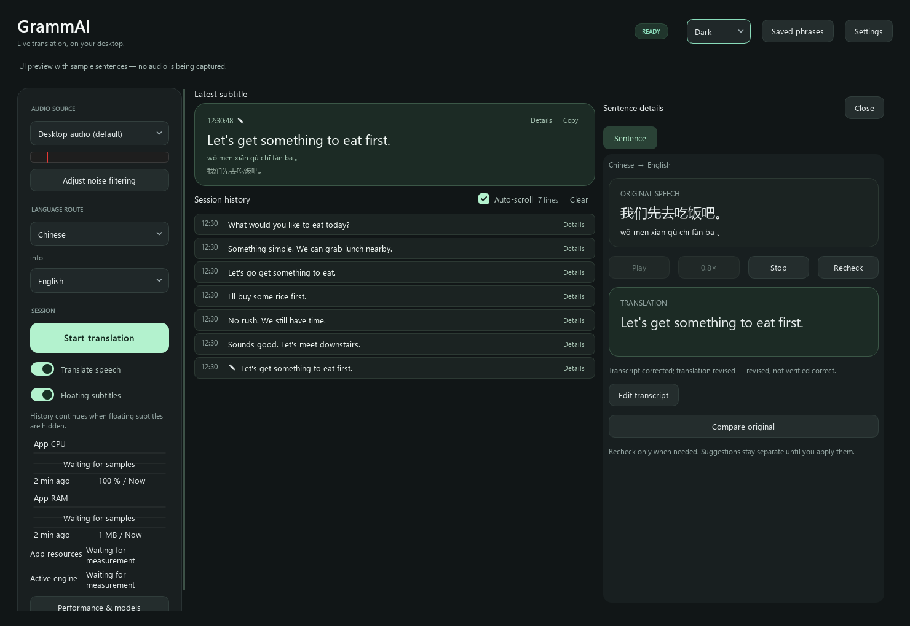

# GrammAI

Windows desktop subtitles with local transcription, translation and pronunciation.



*Actual application UI rendered with sample sentences; no personal conversations or recordings are shown.*

## Run

Windows users can run `dist/GrammAI-Setup-0.2.0.exe` and launch **GrammAI** from
the Start menu or desktop. The portable alternative is `dist/GrammAI-Portable-0.2.0.zip`; extract it and
launch `GrammAI/GrammAI.exe` (keep its whole folder). Python is bundled; model weights remain separate.
See [Windows installation and builds](WINDOWS.md).

For development:

```powershell
python -m pip install -r requirements.txt
python main.py
```

Choose an audio source and languages, then **Start translation**. **Show floating
subtitles** controls the overlay independently; session history continues when the
overlay is hidden. The live audio meter works before translation starts.

## Settings

- **Audio**: desktop loopback or microphone, live input level, draggable noise gate.
- **Languages**: spoken/target languages and overlay pronunciation visibility.
- **Appearance**: live subtitle preview, Cinema/Learning/High contrast presets, 0-100% background opacity, separate HUD opacity, outline/shadow, padding, rounding and screen width. Light/Dark theme and top/bottom placement are saved too.
- **Performance** has three sections:
  - **Configuration**: Low resource / Balanced / Best quality presets, separate
    speech and translation CPU thread budgets, optional Radeon Vulkan setup.
  - **Live monitor**: app CPU and memory (including child processes), active
    backend, speech and translation timings, estimated speech-start-to-result
    delay, queued audio and dropped audio. Updates once per second.
  - **Compare**: benchmark selected settings, then compare with the previous run.

Balanced defaults to Whisper base, beam size 2, four speech threads and two
translation threads. Best quality uses Whisper small and more decoding effort.
Translation uses NLLB-200 distilled 600M with CPU int8 in every preset.

Preferences and the last 20 benchmark summaries are saved under
`%LOCALAPPDATA%\GrammAI`. The latest 80 subtitle entries remain RAM-only and are
cleared on Quit. Compact history rows show each sentence with its timestamp; Details opens pronunciation and the original text. History supports text selection,
Clear and optional auto-scroll. Closing the window hides it to the system tray
when available; use **Quit GrammAI** in the tray to exit.

## Sentence details and manual recheck

Each compact history row has one **Details** action. It opens a resizable side panel with pronunciation,
original audio replay (normal or 0.8x), editable source text, translation and
optional source-first **Meaning & context**. Original speech and translation are
reading cards; **Edit transcript** reveals editing, while **Compare original**
highlights revisions. Selecting another row changes the panel without a modal
dialog. A pencil icon appears only after
wording actually changes; its tooltip distinguishes transcript corrections from
translation revisions. Revised means changed, not verified correct.

**Recheck** transcribes available original audio again with the selected spoken
language and stronger decoding, then translates that source text. If audio has
expired, it explicitly reports **text-only retranslation**. Suggestions need
**Apply revision** before changing history. You can compare the suggestion with
the current wording before accepting it. Every applied revision retains the
first transcript and translation, including across repeated corrections. No-op
rechecks create no revision marker. Live overlay text is not rewritten by history
revisions. Context analysis remains a separate, optional step and always uses
original-language dialogue rather than translations as evidence.

Recheck is manual only: one task runs at a time, and it temporarily pauses live
recognition, then resumes if previously enabled. Its reported duration includes
model loading; resuming live recognition may require loading again. Audio and
text-context rechecks cannot start on top of each other. This first milestone
does not enable automatic or continuous refinement.

Audio clips stay in RAM only, with a 60-second retention window and a fixed
960,000-sample budget (about 3.66 MiB). Old clips expire automatically; device
changes and Quit clear the buffer. A requested recheck snapshots one retained
clip while it runs. Replay suppresses captured audio to avoid recognizing the
app's own playback. Slower replay also lowers pitch.

Save/study controls are removed from the sentence workflow while accuracy is
being evaluated. Existing **Saved phrases** remain readable and deletable;
previous saved data is not removed. A future user-approved learning collection
and Anki export are deferred. Session history and its revisions remain RAM-only,
bounded to 80 entries, and clear on Quit or Clear.

**Settings > Storage** shows replay memory, existing saved text, benchmark
fixtures and model sizes. Model scans never delete shared model caches.

### Accuracy checks and GPU cost

Speech-aware boundaries use the bundled Silero detector plus the noise gate.
Long segments (configured for at least four seconds) allow up to **0.8 seconds**
of endpoint grace before a forced cut, trading some latency for sentence context.
Shorter segments and volume-only boundaries keep their configured hard limit.

A five-clip Google FLEURS Mandarin read-speech check on this RX 7700 XT measured
streaming character error of **2.1%**, down from **5.6%** before the endpoint
adjustment. These small, non-conversational samples are not a general accuracy
claim. Full-clip recognition was 0.7%; translation meaning is not scored by
transcription error rate.

A separate single-clip manual recheck plus Chinese-to-Indonesian translation took
**7.2 seconds including cold loading**, with a sampled GPU peak of **81.7%** and
about **942 MiB dedicated GPU memory**. A short high peak is not sustained usage.
That sample retained one recognition error, and its Indonesian translation still
lost a specific animal term: rechecking does not guarantee improvement. This
standalone measurement does not measure live subtitle delay under concurrency.

Reproduce with cached, public test audio (reports stay under ignored `models/`):

```powershell
python -m scripts.benchmark_speech --clips 5 --backend vulkan
python -m scripts.benchmark_recheck --backend vulkan
```

The speech benchmark optionally downloads Google FLEURS dev clips with
`--download` (CC BY 4.0; attribution in the local manifest). Install optional
`requirements-benchmark.txt` for Traditional/Simplified normalization. Manual
recheck benchmarking requires the cached speech report, audio and local models;
it runs offline and performs no model downloads. Informal multilingual
conversation quality and automatic-refinement resource limits still need
validation before automatic refinement is enabled.

## Quick CPU comparison: transcription only

Turn **Translate speech** off on the main window (also available in Settings >
Languages). Choose a known spoken language instead of Auto-detect, then play the
same speech clip with translation on and off. Check **Performance > Live monitor**
for app CPU and speech/translation timings after each completed sentence.
Transcription-only mode skips NLLB loading and translation, displays the original
transcript with pronunciation, and reports zero translation time. The choice is
saved. It does not change the recognition model or promise better recognition.

The fixed-fixture benchmark below always measures both speech and translation,
regardless of this live-mode switch, to preserve comparability across saved runs.

## Compare configurations

Open **Performance & models > Compare**, select settings under Configuration,
then run the benchmark. Applying settings to live translation is a separate action.
Live inference pauses during the benchmark and resumes afterward if it was enabled.

The benchmark reuses a fixed English speech fixture generated by Windows SAPI.
It measures model loading separately, performs a warm-up, then takes the median
of three speech and three fixed English-to-Chinese text translation runs. It also
records normalized app CPU and sampled process RAM. Results include recognized
and translated text for inspection; they do not produce an accuracy score.

The comparison checks fixture/protocol identity. Changes within 5% are labeled
similar performance; a short test cannot establish a sustained speed advantage.
Speech and translation stage timings exclude collection and queue wait. The live
subtitle-delay estimate includes collection, queue wait and inference. Dropped
audio during intentional pauses/model loading is excluded from the drop counter.
GPU utilization and VRAM readings currently show **Unavailable**.

You can also run the same benchmark from a terminal:

```powershell
python -m core.benchmark --preset fast --preset balanced
```

## Optional Radeon GPU transcription

The app includes a resident whisper.cpp Vulkan server adapter. GPU mode requires:

1. A Windows **Vulkan-enabled whisper-server.exe** and its runtime DLLs.
2. A multilingual whisper.cpp **GGML Whisper model** (`ggml-base.bin`, etc.). The
   faster-whisper and NLLB model files are different and cannot be used here.
3. An AMD graphics driver supporting Vulkan.

Choose Radeon / Vulkan under Performance > Configuration and browse to those
files. The app validates paths on Apply and checks server health and Vulkan model
allocation when starting. A CPU-only server is rejected instead of silently
claiming GPU acceleration. The server binds to localhost on an ephemeral port,
keeps the model resident during translation, and is terminated when its worker
stops. Translation remains CPU-based. Presets adjust decoding effort; the selected
GGML file determines GPU model size. Radeon speech inference has been checked on
this machine; see the Mandarin checks above for the limits of those measurements.

Build/setup documentation: https://github.com/ggml-org/whisper.cpp#vulkan-gpu-support

Server interface: https://github.com/ggml-org/whisper.cpp/tree/master/examples/server

## Models and limitations

The first CPU use downloads Whisper and NLLB weights. NLLB is several hundred MB;
then inference works locally. Use Retry model loading in Performance > Compare
following a download/model failure. Closing stays responsive while waiting for a
current model operation to complete; downloads are not immediately interruptible.

Supported translation routes are English, Chinese, Thai and Indonesian. Failed or unsupported
translations preserve the original transcript and show an unavailable label.
Chinese uses tone-marked pinyin; Thai uses word-segmented romanization without a
full tone representation. Both speech backends use the streaming speech detector when enabled; CPU
transcription can additionally use faster-whisper VAD.

The bounded queue prefers recent input when processing cannot keep pace. CPU
and GPU load while playing a game can differ substantially from a short benchmark.
`--target en`, `--model base`, and `--start-on` override startup behavior.

NLLB weights have a CC-BY-NC-4.0 license; review model terms before commercial
redistribution:
https://huggingface.co/facebook/nllb-200-distilled-600M

Preconverted weights:
https://huggingface.co/JustFrederik/nllb-200-distilled-600M-ct2-int8

## Checks

```powershell
python -m unittest discover -s tests -v
python -m pip check
```

Regression checks cover translation failure, pronunciation, history limits,
preferences, settings Apply/Cancel, meter updates, benchmark coordination,
backend request formatting and worker shutdown. Unit tests use mock GPU backends;
the separate synthetic hardware check below verifies local analysis on the GPU.
# Three-language automatic source

Choose **Auto: English / Chinese / Thai** in the spoken/source language selector
to switch among these languages between speech segments. Your chosen translation
target stays fixed, and the source preference is saved between launches. Chinese
and Thai pronunciation follows the existing subtitle pronunciation settings.
General Auto-Detect and individual fixed languages remain available.

This uses the existing multilingual model. On CPU, ordinary detections within the
three languages use one transcription call. An outside-language detection retries
with the highest-ranked allowed language before consuming the first lazy decoder.
The optional Vulkan speech server can also retry using its reported language probabilities;
the Radeon backend has been checked with Mandarin clips. Short phrases and word-level
language mixing can still be misidentified; fixed source selection remains useful.

## Resource graphs and contextual sentence analysis

Indonesian (Bahasa Indonesia) is available as both a source and translation
target, including corrected-text translation and context analysis. Choose
**Auto: English / Chinese / Thai / Indonesian** for automatic switching among
all four languages. The original three-language group remains available. This
uses the existing multilingual Whisper and NLLB models without extra downloads.

App resources now shows rolling CPU and RAM charts; Settings > Performance >
Live monitor also plots the last completed transcription and translation times.
History covers two minutes in RAM, sampled once per second. Hover for values
and processing markers. CPU includes app child processes as a share of machine
capacity. A timing curve holds the last measured segment; it is not continuous
inference activity. One-second CPU averages may miss very brief spikes.

Live subtitles keep the existing fast pipeline. For deeper review, open a
history item using Details, then Context analysis.
Edit recognition mistakes on the Sentence tab before analyzing. The context
preview contains at most five earlier transcripts from the same capture session;
new subtitle sessions and audio/source changes start a fresh context group.

### Fully local GPU analysis

Settings > Analysis defaults to **Local GPU**. Live Whisper/NLLB behavior stays
independent. Local analysis uses an app-owned llama.cpp Vulkan server bound to
127.0.0.1, a random in-memory API key and proxy bypass. It runs with offline mode
and no tools/web UI. Conversation data never goes to an external service in
local mode, and errors never trigger an online fallback.

Use **Install local model + runtime** for the initial, explicit download: official
Qwen3 4B Q4_K_M (2.50 GB, Apache 2.0) and a pinned official Windows Vulkan runtime
(32 MB). Downloads are checked against pinned SHA-256 values and stored under
`models/local-ai/`, which Git ignores. Interrupted downloads can leave a `.part`
file; retrying setup replaces it. Setup requires an internet connection and at
least 3 GB free disk space. Once installed, analysis works without internet or
API fees. Model-license details: [Qwen model card](https://huggingface.co/Qwen/Qwen3-4B-GGUF).

Enable sentence analysis, choose **Load / verify GPU**, then Apply. The runtime
prefers the RX 7700 XT and requires both a Vulkan device and log-confirmed GPU
layer offloading. It reports errors instead of silently loading on CPU. Use
**Choose existing runtime / model files** for another GGUF instruction model.
Multilingual quality varies; compare actual examples before choosing a larger
model. More VRAM is needed than the GGUF file size alone.

Settings > Analysis > Conversation controls casual/neutral/formal speech,
preserve-tone/natural/literal translation, explanation language (Indonesian by
default), context sentence count (0-5), deeper local reasoning, slang explanations, and a personal
glossary. Settings and explicitly saved examples persist locally in preferences;
these guide inference and do not retrain model weights. The glossary is capped
at 4,000 characters; the first 1,500 characters and up to two examples matching
the current language route are included per request. At most ten examples are
retained, with 800 characters per original/preferred sentence. Edit the glossary
or delete examples in Conversation settings. Changes invalidate cached results.

In History, open **Details > Context analysis**. The input
preview shows the editable original transcript, detected/selected language and
preceding original dialogue. Transcript edits synchronize with the Sentence tab.
Choose **Analyze locally** to interpret the source meaning, intent, slang and
implied subjects first, then generate a fresh translation. Results separate
source meaning, fresh translation, pronunciation, explanations and ambiguity
from the previous translation shown only for comparison. No audio is rechecked.
Nothing changes until **Apply refinement**. The original wording is retained in
Sentence details. Learning-example and phrase-saving controls are deferred from
this workflow while accuracy is being evaluated.

One background analysis task runs at a time. Successful results are cached in
RAM (80 entries); no audio or analysis conversation is archived. Context limits
are configurable from 2,048 to 8,192 tokens. Overlarge inputs show an error rather
than silently dropping the selected sentence. Cancellation terminates an active
local runtime and discards its result; the next analysis reloads it. The app
unloads an idle model after five minutes by default and closes it on exit. Use
Unload to release GPU memory immediately. Remove downloaded Qwen model deletes
only that managed model after confirmation, keeping custom files and the runtime.
Storage scanning includes the managed analysis model and selected external GGUF.

Performance > Live monitor includes analysis/loading markers, last analysis
elapsed time, and Windows PDH GPU counters when available. GPU percentage is the
busiest engine for an app process (including children), not whole-machine GPU
utilization. Dedicated GPU memory is summed for app processes. Missing counters
are shown as unavailable; GPU allocation verification is a separate check.

### Optional online analysis

Online remains available only by explicitly choosing **Online provider** in
Analysis settings. Set an HTTPS chat-completions URL, model ID and an API-key
environment variable. This uses the
[chat-completions message protocol](https://huggingface.co/docs/inference-providers/tasks/chat-completion).
Provider compatibility, charges and retention policies vary. Clicking Analyze
online sends the selected original transcript, source/target languages,
earlier original dialogue, glossary and relevant learning examples; it sends no
audio. API keys are never written to preferences. Online responses have only
been tested with mocks, not a paid live provider.

The existing translation is displayed for comparison but is excluded from model
input and cache identity, so a literal mistranslation does not anchor the analysis
model. Requests whitelist original-source fields instead of forwarding arbitrary
history metadata. A regression test verifies that changing only the previous
translation leaves the model request unchanged. Edits during analysis invalidate
the pending result; Analyze again before applying.

### Repeatable synthetic GPU check

Run `python -m scripts.check_local_analysis --baseline` after setup to compare
four fixed informal expressions with NLLB and local contextual analysis. It
measures loading separately from each analysis, verifies Vulkan layer offloading,
and always unloads afterward. The report is saved to the ignored
`models/local-ai/synthetic-analysis-check.json`. It uses only fixed synthetic
text, captures no audio and makes no automatic semantic-accuracy claim. Review
Thai/Chinese/Indonesian nuances yourself; the supplied review hints help identify
literal mistranslations.

The initial RX 7700 XT hardware run verified Vulkan offloading and loaded the
4B candidate in approximately 1.9 seconds. Four fixed cases took 4.9-8.7 seconds
each with deeper reasoning, compared with 0.22-0.39 seconds for NLLB translation
alone. These are different tasks, not an equal-quality speed comparison. Fast
reasoning-off mode was quicker but mishandled idioms. The deeper mode improved
the Chinese idiom and final Thai example, but informal-speech nuance and requested
explanation language were still inconsistent. This is an experimental tutor,
not a proven accuracy upgrade across all four languages. Always review before
applying. Use `--fast` on the synthetic check to compare modes. Repeated runs can
vary. The model is unloaded after the check.

### Subtitle appearance

Open Settings > Appearance to adjust the overlay with the real subtitle renderer
shown over a sample scene. Background opacity ranges from 0% (transparent) to
100% (solid black) and affects only the subtitle panel; text stays fully opaque.
HUD opacity is separate, and the HUD can be hidden entirely. The overlay remains
frameless, always on top and click-through.

Cinema hides the HUD, pronunciation and original transcript, with outlined text
and a faint panel. Learning shows pronunciation and the original transcript with
a 55% background. High contrast uses larger text and a 90% background. You can
customize font size, text outline/shadow, maximum screen width, padding, corner
rounding and top/bottom placement after choosing any preset. The panel fits its
content and wraps longer subtitles within the configured screen-width limit.

Appearance changes preview on active subtitles without restarting inference or
saving preferences. Apply saves the current choices; Cancel restores the last
applied appearance. Older saved opacity values are retained within the expanded
0-255 internal alpha range. Preview changes do not change the app theme until
Apply. Pronunciation visibility is shared with Languages settings.
